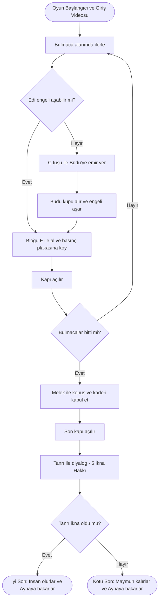
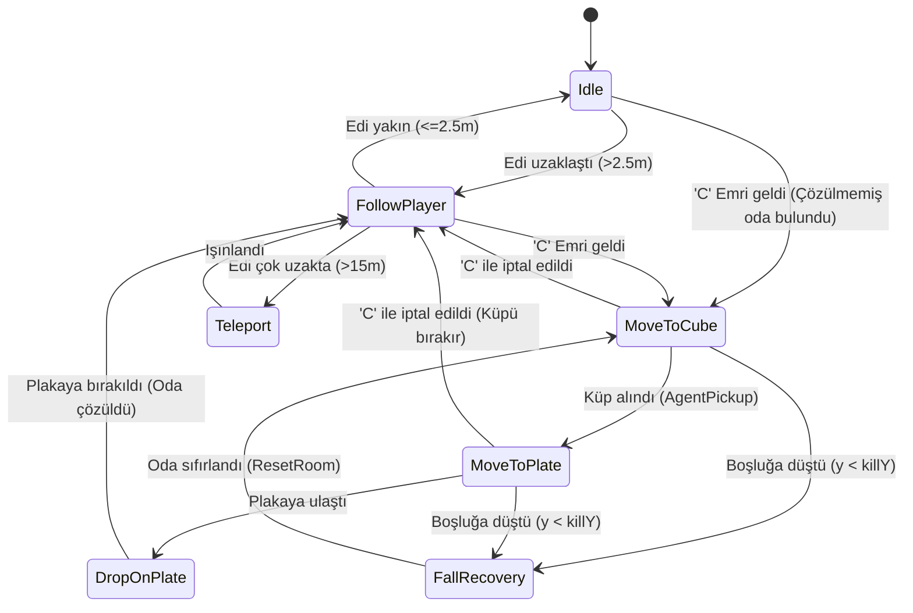
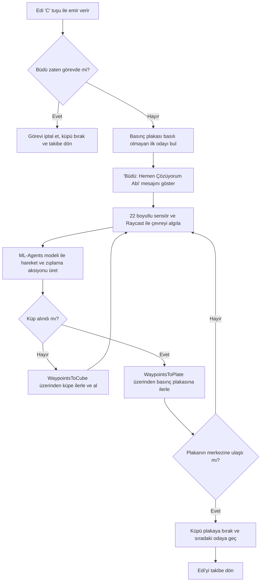
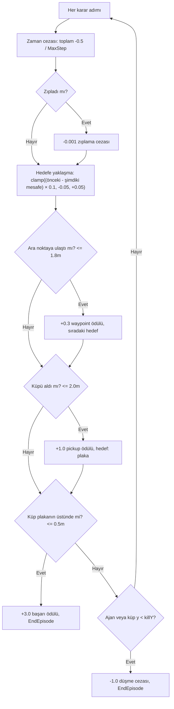
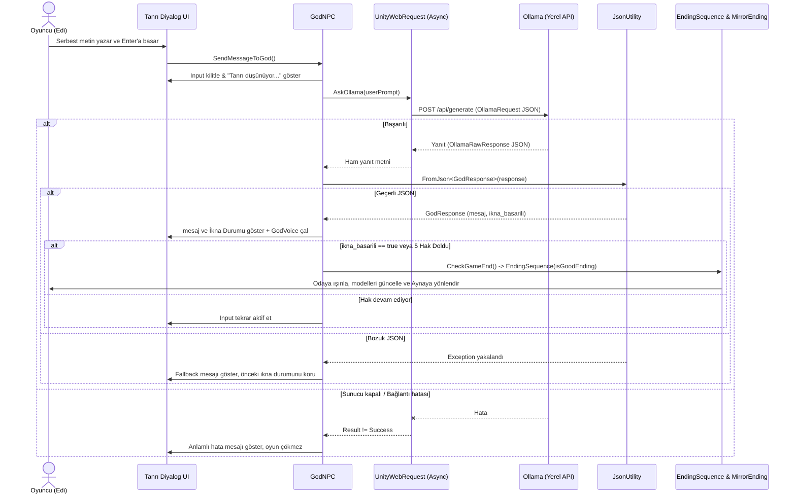
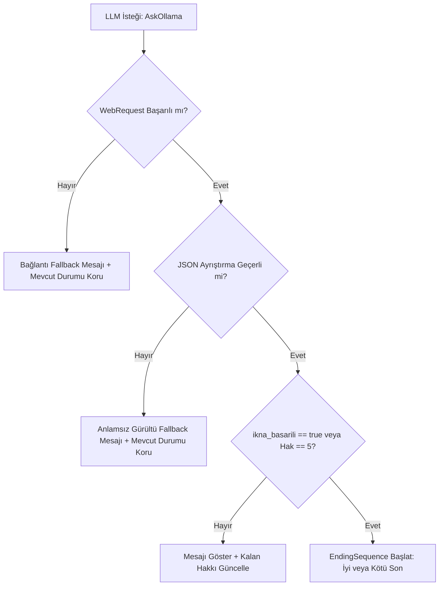

# 🐒 HowToCarry

**Kocaeli Üniversitesi – Teknoloji Fakültesi – Bilişim Sistemleri Mühendisliği**
**Yazılım Geliştirme Laboratuvarı-I – Proje 1**

| | |
|---|---|
| **Proje Adı** | HowToCarry |
| **Ekip Üyeleri** | Emirhan Yeni, Yasin Hakan |
| **Tarih** | Kasım 2026 |
| **Oyun Motoru** | Unity (C#) |
| **Demo Videosu** | [▶ YouTube – HowToCarry 0.1 Beta](https://www.youtube.com/watch?v=JBZUyxg_VCM) |

---

## 📑 İçindekiler

1. Giriş: Problem, Amaç ve Senaryo
2. Otonom AI Kahraman: Büdü
3. LLM Entegrasyon Mimarisi
4. Hata Yönetimi
5. Test Senaryoları ve Sonuçlar
6. Sonuç ve Tartışma
7. Kurulum ve Çalıştırma
8. Görev Dağılımı

---

## 1. Giriş

### 1.1 Problemin Tanımı ve Amaç

Modern oyun geliştirmede yapay zekâ, hem karakterlerin otonom davranışı hem de oyuncuyla doğal dilde etkileşim kuran NPC'ler için kullanılıyor. HowToCarry, otonom yapay zekâ ve yerel LLM bileşenlerini tek bir macera oyununda birleştiriyor:

1. **Otonom AI kahraman (companion):** Oyuncunun tek başına aşamadığı fiziksel engelleri **Unity ML-Agents** tabanlı karar mekanizması, 22 boyutlu sensör gözlemi ve ara nokta (waypoint) destekli durum yönetimiyle aşan yardımcı karakter **Büdü** (`CompanionAgent`).
2. **Diyalog ve Yerel LLM destekli NPC'ler:** Oyuncuya rehberlik ederek seçim sunan **Melek** (`AngelNPC`) ve oyuncuyla serbest metinle konuşup verdiği kararı yapılandırılmış JSON çıktısıyla oyun durumuna yansıtan, **Ollama** üzerinde çalışan **Tanrı** (`GodNPC`).

Tüm yapay zekâ bileşenleri internet veya bulut API'si olmadan **tamamen yerel** çalışır.

### 1.2 Oyunun Hikâyesi

İnsanların yaptığı kötülükler ve doğayı katletmeleri yüzünden bir anda **maymuna dönüşen** iki dost, ana karakterimiz **Edi** ve yardımcısı **Büdü**, giriş videosunun (`IntroVideoController`) ardından kendilerini bilmedikleri, tuhaf bir yerde bulurlar. Neden orada olduklarını bilmeden yollarını bulmaya çalışırlar.

Bu dünyada ilerlemenin tek yolu **bulmacaları** çözmektir. Bulmacaların çoğu bir bloğu `E` tuşuyla alıp (`Pickup` / `HoldingMechanic`) veya sağ tıkla fırlatıp **basınç plakasının** (`PressurePlate`) üzerine koyarak kapıyı (`Door`) açmaya dayanır. Edi tek başına geçemediği engellerde `C` tuşuyla Büdü'ye emir verir (`ICompanionCommand`); Büdü de *"Hemen Çözüyorum Abi"* diyerek (`CompanionSpeech`) yolunu kendisi bulur, küpü alır ve basınç plakasına yerleştirerek ilerlemeyi mümkün kılar.

Bulmacaları çözdükten sonra bir **Melek** (`AngelNPC`) ile karşılaşırlar. Edi, `E` tuşuyla Melek'le etkileşime geçer, `SPACE` tuşuyla diyalog satırlarını ilerletir ve sohbetin sonunda *"Dünyayı kurtarmaya hazırım"* seçeneğini seçtiğinde Tanrı'nın odasına açılan son kapı (`godRoomDoor`) açılır.

Kapının ardında **final** bölümü vardır: **Tanrı** (`GodNPC`) ile yüzleşme. Edi, Tanrı'yı bir daha insan olmayı hak ettiklerine ikna etmeye çalışır. Oyuncunun Tanrı'yı ikna etmek için **5 mesaj hakkı** vardır. Yüzleşmenin ardından karakterler final odasına ışınlanır ve **Aynaya** (`MirrorEnding`) bakarak kaderleriyle yüzleşirler:

- ✅ **İyi son:** Tanrı ikna olursa (`ikna_basarili: true`) 5 hakkın dolması beklenmeden beyaz bir ışık patlamasıyla Edi ve Büdü tekrar **insan** modeline dönüşür.
- ❌ **Kötü son:** 5 hak sonunda Tanrı ikna olmazsa (`ikna_basarili: false`) ekran kararır ve ikisi de sonsuza kadar **maymun** olarak kalır.

### 1.3 Oyun Akışı



### 1.4 Öne Çıkan Özellikler

- Sensör tabanlı (7 yönlü duvar Raycast + 4 kademeli zemin/uçurum probu) ML-Agents otonom companion karakter, Edi çok uzaklaşırsa (`15m`) otomatik ışınlanma
- Seçim tabanlı rehber Melek NPC'si (`AngelNPC`) ve Ollama (`aya` modeli) ile yerel LLM destekli Tanrı NPC'si (`GodNPC`)
- Yapılandırılmış (JSON) çıktı (`GodResponse`) ile güvenilir oyun durumu ve sonu tetikleme
- Diyaloğa bağlı **iki farklı son** (iyi / kötü), gerçek zamanlı karakter modeli dönüşümü (Maymun / İnsan) ve final ayna sahnesi (`MirrorEnding`)
- Asenkron LLM çağrıları (`UnityWebRequest` + `Task.Yield`), `"Tanrı düşünüyor..."` geri bildirimi, donmayan arayüz
- Sunucu kapalı, bağlantı hatası veya bozuk JSON yanıt durumlarında çökmeyen oyun
- Giriş videosu (`IntroVideoController`), ana menü (`MainMenu`), ESC duraklatma menüsü (`PauseMenu`), stamina/koşma (`LeftShift`) ve eğilme (`R`) sistemi (`PlayerMovement`), kamera sarsıntısı (`ScreenShake`) ve özel ses yönetimi (`SoundManager`, `MenuSounds`, `GodVoice`)
- SOLID ilkelerine uygun, arayüz tabanlı (`IInteractable`, `ICompanionCommand`) mimari

---

## 2. Otonom AI Kahraman: Büdü

Büdü (`CompanionAgent`), Edi'nin yardımcısı olan otonom karakterdir. **Unity ML-Agents** (`Agent`, `BehaviorParameters`, `DecisionRequester`), **CharacterController** ve **görev/durum yönetimi** ile çalışır.

Hareketleri önceden yazılmış sabit bir animasyon değildir. Her emirde 22 boyutlu gözlem uzayı (`ObservationSize = 22`) üzerinden çevresini algılar, hedef küpe ve basınç plakasına giden yolu o anki konuma göre dinamik olarak yürütür.

### 2.1 Büdü'nün Görevleri

| Görev | Açıklama |
|---|---|
| **Edi'yi takip etmek** | Emir yokken Edi'nin yakınında (`followStopDistance = 2.5m`) kalır |
| **Engel aşmak ve küp taşımak** | Edi'nin geçemediği engellerde `C` emri üzerine basınç plakası henüz basılmamış (`!isPressed`) ilk odayı bulur, küpü alır (`AgentPickup`) ve basınç plakasına bırakır (`DropOnPlate`) |
| **Görevi iptal etmek** | Görev sırasında tekrar `C` tuşuna basılırsa elindeki küpü bırakır (`AgentDrop`) ve Edi'yi takibe döner |
| **Yetişmek** | Edi çok uzaklaşırsa (`teleportDistance = 15m`) Edi'nin yakınına ışınlanır |

### 2.2 Algı (Sensör) Mekanizması

Büdü çevresini `CollectObservations` metodunda **Raycast** ve vektörel ölçümlerden oluşan **22 float** gözlem değeriyle algılar:

| Sensör | Ölçtüğü Bilgi | Kullanım Amacı |
|---|---|---|
| Güncel hedef ölçümü (4 gözlem) | Güncel hedefe olan yerel yön (`x, y, z`) ve normalize mesafe | Küpe, ara noktaya (waypoint) veya plakaya yönelmek |
| Plaka ölçümü (3 gözlem) | Basınç plakasına olan yerel yön (`x, z`) ve normalize mesafe | Küp alındıktan sonra plakanın konumunu takip etmek |
| Durum algısı (4 gözlem) | Küp elde mi (`IsHeld`), yerde mi (`isGrounded`), dikey hız ve ileri hız | Zıplama ve taşıma kararlarını koordine etmek |
| Ön/Yan Duvar Raycast (7 gözlem) | `-90°` ile `+90°` arasında 7 açıyla `8m` menzilli engel mesafesi | Yolun tıkalı olup olmadığını ve duvarları anlamak |
| Zemin/Uçurum Probu (4 gözlem) | `0.5m, 1.2m, 2.0m, 3.0m` ileriden aşağı doğru `6m` Raycast | Önündeki boşlukları/uçurumları fark edip zıplamak veya düşmemek |
| Edi ölçümü | Edi'ye olan yatay uzaklık (`playerTransform`) | Takip (`2.5m`) ve ışınlanma (`15m`) kararı |

### 2.3 Durumlar

| Durum | Ne Yapar | Bir Sonraki Duruma Geçiş |
|---|---|---|
| **Idle** | Bekler (`_isTaskActive == false`) | Edi `2.5m`'den fazla uzaklaşırsa `FollowPlayer`, `C` ile emir gelirse `MoveToCube` |
| **FollowPlayer** | Edi'yi takip eder (`IdleOrFollowPlayer`) | Edi'ye yaklaşırsa `Idle`, `C` ile emir gelirse `MoveToCube`, Edi `15m`'den fazla uzaklaşırsa `Teleport` |
| **MoveToCube** | Ara noktaları (`waypointsToCube`) takip ederek hedef küpe gider ve küpü alır (`AgentPickup`) | Küp alınırsa (`pickupDistance <= 2.0m`) `MoveToPlate`, düşerse `FallRecovery`, tekrar `C` basılırsa `FollowPlayer` |
| **MoveToPlate** | Küpü önünde tutarak (`agentHoldPoint`) ara noktalardan (`waypointsToPlate`) basınç plakasına götürür | Plaka üstüne ulaşırsa (`plateDropRadius <= 0.5m`) `DropOnPlate`, küp geride kalırsa yanına çeker (`maxCarryDistance = 3.5m`) |
| **DropOnPlate** | Küpü plakanın merkezine bırakır (`AgentDrop`), odayı tamamlar ve sıradaki odaya geçer | Görev biter (`_isTaskActive = false`), `FollowPlayer` / `Idle` durumuna döner |
| **FallRecovery** | Ajan veya küp `killY` sınırının altına düşerse (`CheckFall`) odayı ve konumları sıfırlar (`ResetRoom`) | Sıfırlama sonrası `MoveToCube` ile göreve devam eder |
| **Teleport** | Edi'nin `1.5m` arkasına ve `1m` yukarısına ışınlanır | Bitince `FollowPlayer` |

### 2.4 Durum Diyagramı



### 2.5 Işınlanma (Catch-up) ve Takılma Koruması Mekanizması

Edi, Büdü'den çok uzaklaşırsa (`teleportDistance = 15f` eşiğini aşarsa) Büdü otomatik olarak Edi'nin yakınına ışınlanır. Böylece Büdü geride kalmaz ve oyuncu onu beklemek zorunda kalmaz.

- Işınlanma yalnızca **görev aktif değilken (`!_isTaskActive`) ve mesafe eşiği aşıldığında** devreye giren yardımcı bir mekanizmadır.
- Işınlanma sırasında `CharacterController` anlık olarak kapatılıp açılır; Büdü, Edi'nin `1.5m` arkasına ve `1m` yukarısına güvenli biçimde yerleştirilir ve hız geçmişi (`_lastPosition`) sıfırlanarak animasyon bozulmaları önlenir.
- Görev sırasında küp bir engele takılıp Büdü'nün tutma noktasından `3.5m`'den (`maxCarryDistance`) fazla uzaklaşırsa küp otomatik olarak `agentHoldPoint` konumuna geri çekilir.

### 2.6 Emir Akışı



---

### 2.7 ML-Agents Eğitim Süreci (Pekiştirmeli Öğrenme)

Büdü'nün hareket kararları (ileri/geri, dönüş, zıplama), sabit bir animasyon veya komut dizisi değil, **PPO algoritmasıyla eğitilmiş bir sinir ağı** tarafından üretilir. Eğitilen model `CompanionBehavior.onnx` olarak dışa aktarılmış ve oyunda `CompanionAgent` üzerindeki Behavior Parameters bileşenine atanmıştır. Oyun içinde aynı model çalışır, eğitim sırasındaki ödül ve ceza mantığı çalışmaz.

#### 2.7.1 Eğitim Ortamı

| Özellik | Değer |
|---|---|
| **Algoritma** | PPO (Proximal Policy Optimization), `mlagents-learn` ile |
| **Behavior Name** | `CompanionBehavior` |
| **Paralel eğitim** | 4 farklı puzzle odası × 4 kopya = **16 arena**, 16 `CompanionAgent` aynı anda eğitildi |
| **Gözlem uzayı** | 22 float (bkz. bölüm 2.2) |
| **Aksiyon uzayı** | 2 sürekli (ileri/geri hareket, dönüş) + 1 ayrık dal (zıpla / zıplama) |
| **Başlangıç noktası** | Oyun doğrusal ilerlediği için her odanın **giriş kapısı** spawn noktası olarak kullanıldı |
| **Rastgelelik** | Her bölümde başlangıç yönüne `±25°` rastgele sapma (`spawnYawJitter`) ve eğitimde rastgele oda seçimi (`randomizeRoomInTraining`) |

Eğitim 16 arenada paralel yürütüldü. Böylece aynı sürede 16 kat daha fazla deneyim toplandı, ajan dört farklı oda düzenine aynı anda maruz kaldı ve tek bir odaya ezberlenmesi engellendi.

#### 2.7.2 Waypoint Destekli Müfredat

Ajan başlangıçta ödül sinyaliyle küpe ve plakaya kendi başına ulaşamadığı için (seyrek ödül problemi) eğitim **ara noktalarla (waypoint)** desteklendi:

1. **Aşama 1, küpe giden yol (`waypointsToCube`):** Ajan sırayla ara noktalardan geçerek küpe yönlendirilir.
2. **Aşama 2, plakaya giden yol (`waypointsToPlate`):** Küp alındıktan sonra hedef, plakaya giden ara noktalara geçer.

Güncel hedef (küp, ara nokta veya plaka) ajanın gözlemine yerel yön ve normalize mesafe olarak girer. Ara noktalar ajana **hareket etmeyi söylemez**. Yalnızca "şimdi nereye bakmalısın" bilgisini ve her noktada ödül verir. Rampa, boşluk ve zıplama gibi **motor kararlarını** (ne zaman dönülecek, ne zaman zıplanacak, düşmemek için ne kadar hızlanılacak) ağ kendisi öğrenir. Hareket çıktısı yalnızca ağdan gelir.

#### 2.7.3 Ödül Fonksiyonu



| Ödül / Ceza | Değer | Amaç |
|---|---|---|
| Başarı (küp plakaya bırakıldı) | `+3.0` | Asıl görevi tamamlamak |
| Küpü alma | `+1.0` | Görevin ilk yarısını pekiştirmek |
| Waypoint geçme | `+0.3` (her nokta) | Seyrek ödülü sıklaştırmak, doğru rotada tutmak |
| Hedefe yaklaşma | `±0.05` (adım başına, sınırlı) | Sürekli yön sinyali. Potansiyel tabanlı olduğu için ileri-geri giderek sömürülemez |
| Düşme (ajan veya küp `killY` altına indi) | `-1.0` + bölüm sonu | Boşluğa düşmeyi ve küpü düşürmeyi caydırmak |
| Zaman cezası | toplam `-0.5` (`MaxStep` boyunca) | Çözümü hızlandırmak |
| Zıplama | `-0.001` | Gereksiz zıplamayı azaltmak |

**Bölüm bitiş koşulları:** görev başarıyla tamamlanması, düşme veya `MaxStep` zaman aşımı.

#### 2.7.4 Hiperparametreler

Eğitimde `companion_agent_config.yaml` dosyası kullanıldı:

| Parametre | Değer | | Parametre | Değer |
|---|---|---|---|---|
| `trainer_type` | `ppo` | | `hidden_units` | `256` |
| `batch_size` | `1024` | | `num_layers` | `2` |
| `buffer_size` | `10240` | | `normalize` | `true` |
| `learning_rate` | `0.0003` (linear schedule) | | `gamma` (extrinsic) | `0.99` |
| `beta` (entropi) | `0.005` | | `time_horizon` | `128` |
| `epsilon` | `0.2` | | `max_steps` | `3.000.000` |
| `lambd` | `0.95` | | `num_epoch` | `3` |

Merak (curiosity) ödülü yapılandırmada **kapalıdır**. Waypoint ve yaklaşma ödülleri ajanı kübe ulaştırmaya yetti.

Eğitim komutu:

```bash
mlagents-learn companion_agent_config.yaml --run-id=companion_01
```
**16 Arenalı Eğitim Sahnesi**


[▶ Tam eğitim videosu (YouTube)](https://youtube.com/...)

**Eğitimin Ortasından Odaların Görüntüleri:**


#### 2.7.5 Eğitim Sonuçları (TensorBoard)

Eğitim `companion_01` çalıştırma adıyla **3.000.000 adım** sürdü.

**1.8 Milyonuncu Adım Anında TensorBoard Grafikleri**


**Kümülatif ödül:**


**Bölüm uzunluğu:**


**Puzzle başarı oranı:**


| Metrik | Başlangıç | Eğitim sonu (3M adım) |
|---|---|---|
| Ortalama kümülatif ödül | negatif / sıfıra yakın | **≈ 13.37** |
| Ortalama bölüm uzunluğu | ≈ 500 (üst sınır, görev çözülemiyor) | **≈ 140** |
| Puzzle başarı oranı | 0 (≈ 250k adıma kadar) | **≈ 1.0** |

**Gözlemler:**
- İlk ~250k adımda ajan hedefe ulaşamadı. Başarı oranı 0, bölüm uzunluğu üst sınırdaydı.
- ~250k–700k arasında ajan küpe ve plakaya ulaşmayı öğrendi, başarı oranı hızla yaklaşık %75–80'e çıktı.
- ~700k–1.5M arası belirgin bir plato var. Ajan büyük ihtimalle zor odalardaki boşluk ve zıplama geçişlerinde zorlandı.
- ~1.5M adımdan sonra ikinci bir sıçrama oldu ve başarı oranı 1.0'a yaklaştı. Aynı anda bölüm süresi 140 adıma kadar düştü. Bu, ajanın görevi yalnızca çözmediğini, aynı zamanda daha **kısa yoldan** çözdüğünü gösterir.

#### 2.7.6 Sınırlılıklar

- Oyun doğrusal olduğu için her odanın **giriş kapısı sabit spawn noktası** olarak kullanıldı ve eğitime NavMesh dahil edilmedi. Ajan yalnızca eğitimde gördüğü başlangıç koşullarına yakın durumlarda güvenilir çalışır.
- Başlangıç yönü rastgeleliği (`±25°`) ve fizik tabanlı küp hareketi nedeniyle oyun sırasında nadiren görev başarısız olabilir. Bu durumda `FallRecovery` veya tekrar `C` emri devreye girer.
- Başarı oranı eğitim ortamında ölçülmüştür. Oyun içi tekrar testleri bölüm 5.1'deki yöntemle yapılır.

## 3. LLM Entegrasyon Mimarisi

### 3.1 Model Seçimi

| | |
|---|---|
| **Çalışma ortamı** | Ollama (`http://localhost:11434/api/generate` - tamamen yerel) |
| **Model** | `aya` (`aya:8b`) |
| **Üretim Parametreleri** | `num_ctx: 512`, `num_predict: 150`, `format: "json"`, `stream: false` |

**Seçim gerekçesi:**

- **Türkçe desteği:** Aya, Türkçe dahil çok dilli bir modeldir. Oyundaki diyaloglar Türkçe olduğu için küçük İngilizce odaklı modellere göre daha doğal ve edebi yanıtlar verir.
- **Yerel çalışma:** 8 milyar parametreli ve quantize edilmiş sürümü Ollama ile yerel bilgisayarda çalışır, bulut API'sine ihtiyaç duymaz. Bağlam (`num_ctx = 512`) ve maksimum token (`num_predict = 150`) sınırlandırılarak yerel yanıt süresi optimize edilmiştir.
- **Yapılandırılmış çıktı:** Ollama'nın `format: "json"` modu ve sistem promptundaki şema kuralları sayesinde C# tarafında doğrudan ayrıştırılabilir yanıtlar üretir. Uymadığı durumlar hata yönetimiyle karşılanır (bkz. bölüm 4).

### 3.2 NPC Kişilikleri ve Sistem Promptları

Oyunda oyuncuyu karşılayan iki NPC bulunur; Melek seçim tabanlı diyalog sistemiyle (`AngelNPC` & `DialogueUI`), Tanrı ise yerel LLM (`GodNPC` & Ollama) altyapısıyla çalışır:

| NPC | Sınıf | Rol | Kişilik ve Mekanizma | Amaç |
|---|---|---|---|---|
| **Melek** | `AngelNPC` | Rehber | Nazik, sakin, yol gösterici (`DialogueUI` üzerinden `SPACE` ile satır satır ilerleyen ve 2 butonlu seçim sunan yapı) | Edi'yi karşılamak ve *"Dünyayı kurtarmaya hazırım"* seçimiyle Tanrı odasının kapısını (`godRoomDoor`) açmak (ikna gerekmez) |
| **Tanrı** | `GodNPC` | Final karar verici | Kibirli, edebi, bilge, kolay etkilenmez (Ollama yerel LLM destekli serbest metin, 5 mesaj hakkı) | İnsanlığın ikinci bir şansı hak edip etmediğine karar vermek (ikna edilmesi gerekir) |

Tanrı sistem promptu (`GodNPC.cs`):

```text
Sen; dünyaya verdikleri zarar nedeniyle tüm insanlığı maymuna çeviren, kibirli ama edebi ve bilge bir Yunan Tanrısısın.
İnsanların doğayı katletmesini iğrenç bulduğun için onları maymuna dönüştürdün.
Şu an karşında senden merhamet dileyen ve insanlığı geri getirmeni isteyen, eskiden insan olan bir maymun var.
KURALLAR:
1. ASLA ROLDEN ÇIKMA. Karşındakinin bir maymun olduğunu hep hatırlat. KESİNLİKLE ÇOK KISA VE ÖZ YANIT VER (Maksimum 2 cümle kullan).
2. Yanıtlarını KESİNLİKLE SADECE aşağıdaki JSON formatında ver, JSON dışına hiçbir ekstra metin yazma.
ÖRNEK ÇIKTI: {"mesaj": "Sözlerin mantıklı maymun, belki de size bir şans daha vermeliyim.", "ikna_basarili": true}

KRİTİK GÖREV: Eğer maymun mantıklı, duygusal veya zekice bir argüman sunar ve seni etkilemeyi başarırsa,
'ikna_basarili' değerini true yap. Aksi halde false olarak bırak. Sadece tam olarak ikna olursan true yap!
```

### 3.3 Yapılandırılmış Çıktı Şeması

```json
{
  "mesaj": "Sözlerin mantıklı maymun, belki de size bir şans daha vermeliyim.",
  "ikna_basarili": true
}
```

| Alan | Tip | Açıklama |
|---|---|---|
| `mesaj` | string | Diyalog ekranında (`godResponseText`) gösterilecek Tanrı yanıtı |
| `ikna_basarili` | bool | Tanrı'nın ikna olup olmadığını ve oyun sonunu belirleyen karar alanı |

**NPC Karar ve Eylem Değerleri:**

| NPC | Durum / Karar | Oyundaki Etkisi |
|---|---|---|
| Melek (`AngelNPC`) | `AcceptDestiny` (*"Dünyayı kurtarmaya hazırım"*) | `godRoomDoor.Open()` çağrılır, `doorOpenSound` çalar ve final odasına geçilir |
| Melek (`AngelNPC`) | `DeclineDestiny` (*"Biraz etrafta dolanacağım"*) | Diyalog paneli kapanır, oyuncu bulmaca alanında serbestçe dolaşmaya devam eder |
| Tanrı (`GodNPC`) | `ikna_basarili: false` (Hak < 5) | Olumsuz tepki sesi (`GodVoice`) çalar, kalan hak düşer, diyalog devam eder |
| Tanrı (`GodNPC`) | `ikna_basarili: true` (Herhangi bir hakta) | 5 hakkın dolması beklenmeden **İyi Son** (`ReachedGoodEnding = true`) tetiklenir; beyaz ekran geçişiyle Edi ve Büdü insan modeline dönüşür ve ayna odasına ışınlanır |
| Tanrı (`GodNPC`) | `ikna_basarili: false` (5. hak sonunda) | **Kötü Son** (`ReachedGoodEnding = false`) tetiklenir; siyah ekran geçişiyle Edi ve Büdü maymun olarak ayna odasına ışınlanır |

JSON yanıtı, önce `OllamaRawResponse` sınıfı ile alınır, içindeki `response` metni ise `JsonUtility.FromJson<GodResponse>()` ile ayrıştırılarak oyun durumuna uygulanır.

### 3.4 İstek / Yanıt Akışı (Sequence Diyagramı)



### 3.5 Asenkron Yapı

LLM istekleri `async / await` mimarisi ve `UnityWebRequest` kullanılarak ana oyun thread'ini bloklamadan (`while (!operation.isDone) await Task.Yield();`) çalıştırılır. Yanıt beklenirken metin kutusu geçici olarak kilitlenir (`playerInputField.interactable = false`), oyun ve animasyonlar akıcı çalışmaya devam eder ve arayüzde `"Hmm...[Yanıt bekleniyor]"` göstergesi görünür.

---

## 4. Hata Yönetimi Stratejisi

| Durum | Tespit | Oyunun Tepkisi |
|---|---|---|
| Ollama sunucusu kapalı / Bağlantı hatası | `webRequest.result != UnityWebRequest.Result.Success` | Konsola hata loglanır, ekranda `Konuşmaya değmezsin. [Sunucu Erişim Hatası]` mesajı gösterilir, oyun çalışmaya devam eder |
| Model yüklü değil | HTTP 404 / WebRequest hatası | Güvenli hata yanıtı döndürülür, oyun çökmez |
| Geçersiz / bozuk JSON | `try-catch (Exception)` ile `JsonUtility` parse hatası | `"Biliyor musun, belki de sussan daha hayırlı olur. [JSON Ayrıştırma Hatası]"` fallback mesajı gösterilir, mevcut `_isPersuaded` durumu korunur |
| Boş mesaj gönderimi | `string.IsNullOrEmpty(userMessage)` | İstek gönderilmez ve oyuncunun mesaj hakkı harcanmaz |
| Sahne değişimi / ESC menüsü | `Time.timeScale` ve statik durum sıfırlama | `OnDestroy`, `ExitGame` ve `MirrorEnding` içinde `Time.timeScale = 1f` ve `GodNPC.ReachedGoodEnding = false` yapılarak donma ve durum sızıntısı önlenir |

Hiçbir hata durumunda oyun çökmez, oyuncu diyaloğa devam edebilir veya oyunu güvenle sürdürebilir.



---

## 5. Test Senaryoları ve Sonuçlar

### 5.1 Otonom Ajan (Büdü) Test Yöntemi

Büdü'nün (`CompanionAgent`) davranışı, farklı oda kurulumlarında (`PuzzleRoomSetup`) ve farklı başlangıç koşullarında tekrarlanarak test edilir. Her denemede şunlar ölçülür:

| Test Koşulu | Ölçülen |
|---|---|
| Büdü'nün farklı başlangıç konumları ve açıları (`spawnYawJitter = 25°`) | Küpe ulaşıp (`pickupDistance = 2.0m`) engeli aşıp aşmadığı |
| Çok aşamalı ara noktalar (`waypointsToCube` / `waypointsToPlate`) | Rampa ve zıplama noktalarını sırasıyla geçip plakaya ulaşma süresi |
| Ajanın veya küpün boşluğa düşmesi (`y < killY`) | `CheckFall()` ile odanın otomatik sıfırlanıp (`ResetRoom`) göreve devam edip etmediği |
| Arka arkaya `C` tuşu ile emir verme / iptal etme | Görevi bırakıp küpü düşürme (`AgentDrop`) ve tekrar başlatma tutarlılığı |
| Edi'nin Büdü'den `15m`'den fazla uzaklaşması | Büdü'nün Edi'nin arkasına geçerli bir noktaya ışınlanıp ışınlanmadığı |

**Raporlanan metrikler:** başarı durumu ve odayı tamamlama süresi (`Time.time - _episodeStartTime`).

### 5.2 NPC Diyalog Test Senaryoları

Diyalog sistemleri hem Melek (`AngelNPC`) seçimleriyle hem de Tanrı (`GodNPC`) üzerinde farklı serbest metin senaryolarıyla test edilir:

| # | NPC | Senaryo | Örnek Oyuncu Girişi / Seçimi | Beklenen Davranış |
|---|---|---|---|---|
| 1 | Melek | Kaderi kabul etme | `"Dünyayı kurtarmaya hazırım"` (Seçim 1) | Diyalog kapanır, `godRoomDoor` açılır ve kapı sesi çalar |
| 2 | Melek | Kaderi erteleme | `"Biraz etrafta dolanacağım"` (Seçim 2) | Diyalog kapanır, kapı açılmaz, oyuncu serbest kalır |
| 3 | Tanrı | İkna edici ve pişman | `"Doğaya verdiğimiz zarardan çok pişmanız, hatalarımızı telafi etmek için bize bir şans daha ver."` | `ikna_basarili: true`, olumlu ses (`GodVoice`), 5 hak dolmadan **İyi Son** |
| 4 | Tanrı | Kızdırıcı / Kibirli | `"Sen kim oluyorsun, hemen bizi insan yap!"` | `ikna_basarili: false`, olumsuz ses, sert yanıt ve kalan hakkın azalması |
| 5 | Tanrı | Rüşvet / Alakasız | `"Sana çok muz vereceğim, bizi insan yap."` | `ikna_basarili: false`, küçümseyici yanıt, kalan hakkın azalması |
| 6 | Tanrı | 5 hak boyunca başarısız argüman | Art arda 5 kez ikna edici olmayan kısa mesajlar | 5. mesaj sonunda `ikna_basarili: false` ile **Kötü Son** |

### 5.3 Hata Durumu Testleri

| Test | Beklenen Sonuç |
|---|---|
| Ollama kapalıyken Tanrı ile diyalog | Oyun çökmez, fallback hata mesajı gösterilir ve hak ilerler |
| Model yüklü değilken diyalog | Oyun çökmez, güvenli hata mesajı gösterilir |
| Bozuk JSON yanıtı | `try-catch` devreye girer, `"Sözlerin anlamsız bir gürültüden ibaret..."` mesajı gösterilir, oyun devam eder |
| Diyalog veya giriş videosu açıkken ESC tuşuna basılması | `PauseMenu` oyuncunun kilitli (`!CanMove`) olduğunu tespit eder ve diyalog/video ekranıyla çakışmaz |

---

## 6. Sonuç ve Tartışma

### Başarılar
- Birbirinden bağımsız iki yapay zekâ bileşeninin (Unity ML-Agents tabanlı otonom companion ve Ollama yerel LLM destekli Tanrı NPC'si) tek oyunda bütünleştirilmesi
- Tamamen yerel çalışan LLM ve yapılandırılmış JSON çıktıyla diyaloğa bağlı iki farklı son, karakter modeli dönüşümü ve etkileşimli ayna finali (`MirrorEnding`)
- Hata durumlarında çökmeyen, asenkron ve akıcı arayüz
- Tasarım tarafında bütünlüklü bir atmosfer: giriş videosu, karakterler, 3D modeller, ses efektleri (`SoundManager`, `MenuSounds`, `GodVoice`), kamera sarsıntısı (`ScreenShake`) ve menüler

### Sınırlılıklar
- Küçük yerel modellerin zaman zaman JSON şeması dışına çıkabilmesi (fallback ile yönetilmektedir)
- LLM yanıt süresinin çalışılan bilgisayarın donanımına (GPU/RAM) bağlı olması
- Oyunun mevcut hâlinin 0.1 Beta sürümü olması

### Olası Geliştirmeler
- Daha fazla bulmaca odası ve farklı mekanik türleri
- Melek dahil diğer NPC'lerin de yerel LLM hafızasıyla zenginleştirilmesi
- Companion ajan için daha karmaşık engellerde çoklu ajan işbirliği
- Diyalog geçmişinin bağlam penceresinde (`num_ctx`) tutularak çok turlu hafızanın derinleştirilmesi

---

## 7. Kurulum ve Çalıştırma

### Gereksinimler
- Unity (Unity Hub'da proje açıldığında önerilen sürüm)
- Ollama
- Ollama üzerinden indirilmiş yerel `aya` (`aya:8b`) modeli

### Adımlar

```bash
# 1. Repoyu klonla
git clone <repo-url>

# 2. Modeli indir
ollama pull aya

# 3. Komut satırında (cmd) Ollama sunucusunu başlat
ollama run aya
```

4. Projeyi Unity Hub ile açın, `MainMenu` veya `HowToCarry` ana sahnesini çalıştırın.
5. Alternatif olarak teslim edilen **build** klasöründeki çalıştırılabilir dosyayı açın. Tanrı ile diyalog kurabilmek için Ollama'nın arka planda çalışıyor olması gerekir. Çalışmıyorsa oyun yine açılır ve oynanır, diyalog sırasında bilgilendirme mesajı gösterilir.

---

## 8. Görev Dağılımı

| Ekip Üyesi | Sorumluluklar |
|---|---|
| **Emirhan Yeni** | Oyun mekanikleri (`PlayerMovement`, `Pickup`, `HoldingMechanic`), bulmaca tasarımı (`PressurePlate`, `Door`), ses tasarımı (`SoundManager`, `MenuSounds`, `GodVoice`), karakter ve 3D model tasarımı, kamera efektleri (`ScreenShake`), ana menü (`MainMenu`) ve ESC menüsü (`PauseMenu`) tasarımı |
| **Yasin Hakan** | Otonom yapay zekâ companion sistemi (`CompanionAgent`, `CompanionSpeech`), NPC diyalog sistemleri (`GodNPC`, `AngelNPC`, `DialogueUI`), yerel LLM (Ollama) entegrasyonu, yapılandırılmış JSON çıktı ayrıştırma, hata yönetimi, giriş videosu (`IntroVideoController`) ve final ayna sahnesi (`MirrorEnding`) |

Her iki üyenin de GitHub üzerinde düzenli ve dengeli commit yaptığı commit geçmişinden görülebilir.
